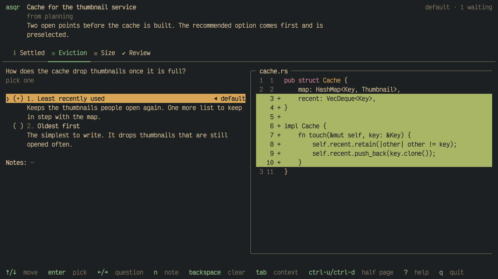

Your agent saved up some questions. Answer them all in one go, right in
your terminal.

asqr (pronounced "asker") shows you the questions your AI coding agent has
prepared, in a terminal of its own. You work through them at your own
pace: pick options, type your own answers, write notes, and skip what you
cannot decide yet. When you submit, your agent reads your answers and goes
on. A script can ask the same way.

The chameleon is Talqi (pronounced like "talkie"), asqr's mascot.

## How it works

1. Start `asqr` in a terminal of its own and leave it running.
2. Tell your agent to use asqr, for example "Use asqr to ask me the open
   questions about the release."
3. The session shows up in asqr. You answer its questions and submit
   them.
4. Your agent reads your answers and goes on.

A question can come with what you need to decide it: a diff, a file, a
log or an image, shown beside the question. Here each option shows its
own diff, so you see what each choice would change:

## Where to go next

- [Get started](01M68ASRJ527YVE41S9V50YXQW-get-started.md) installs asqr
  and takes you through a first session with your own agent.
- [Common questions](01M690YKZXCMGCA31H3HTHFYJE-common-questions.md)
  answers what new users ask, such as why asqr needs no MCP server.
- [Answering a session](01M6916HYT9Z4N422AX47A8JQH-answering-a-session.md)
  covers what you need for most sessions, and the pages after it the
  details.
- [What your agent can ask you](01M68C6WV57K25ZD05875QJY73-what-your-agent-can-ask-you.md)
  shows how to ask for a session and what sessions look like.
- [How an agent asks](01M68C6WTNJGM2A5WY0C3EYKRT-how-an-agent-asks.md)
  shows what your agent writes and what it gets back.
- [Queues](01M68C1XV58STWHBH179QYXPZR-queues.md) keeps the questions of
  your projects apart.
- [Keys](01M68AZYKWFPJAHTFZ0JPNNAK7-keys.md) lists every key.
