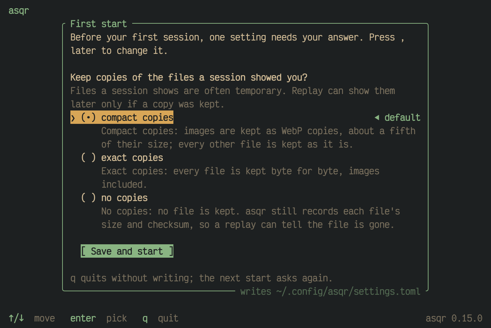
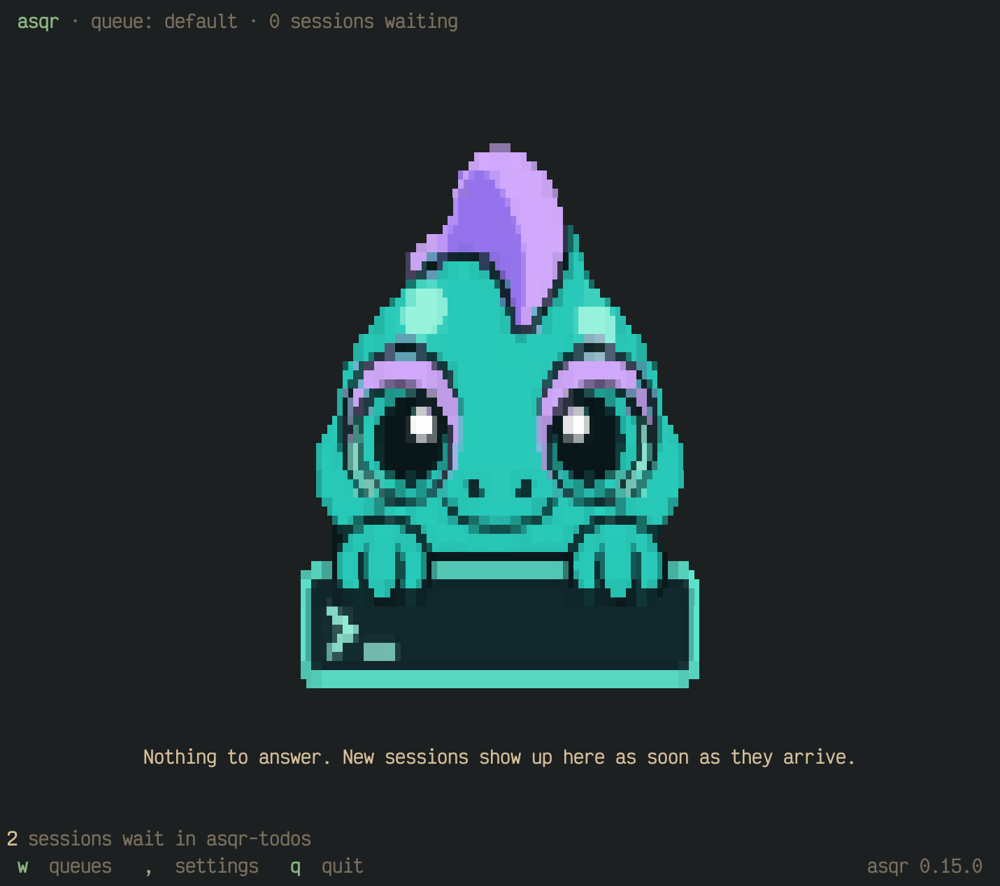

This page installs asqr and takes you through a first session with your
own agent: you ask it to use asqr, answer its questions, and it reads your
answers back. The example uses Claude Code. asqr needs nothing from your
agent but running shell commands and writing files.

## What you need

- macOS or Linux. Windows may work but is not tested.
- A terminal of at least 60 columns by 15 rows.
- An agent that runs shell commands, such as Claude Code.

## Install

With Homebrew, on macOS and Linux:

```sh
brew install jakobwesthoff/tap/asqr
```

From crates.io, which needs Rust 1.97 or newer and a C compiler, as it
builds libwebp (Xcode's command line tools on macOS, `cc` or `gcc` on
Linux):

```sh
cargo install asqr
```

Every GitHub release also carries prebuilt binaries for macOS (Apple
silicon and Intel) and Linux (x86_64 and aarch64).

## Start asqr

Open a terminal of its own and start asqr:

```sh
asqr
```

With tmux, open a tmux session and start asqr in one pane and your agent
in a second pane of the same tmux session:

```sh
tmux new -s myproject
```

Start both the same way: in panes of one tmux session, or both outside
tmux. Inside tmux, asqr and the agents of the same tmux session use one
queue without any setup. Outside tmux, both use the default queue.

> [!TIP]
> In tmux, put `set -g allow-passthrough all` into your tmux
> configuration, so desktop notifications and images reach your terminal.
> [Notifications, the terminal and
> tmux](01M68C1XVP8WV9Z6NWRJ1BEWT8-notifications-the-terminal-and-tmux.md)
> says why.

The first time asqr starts without a settings file, and `ASQR_KEEP_FILES`
is not set, it asks one question before anything else: whether it keeps
copies of the files a session showed. Pick a value with `↑`/`↓` and `enter`, then press `enter` on
`[ Save and start ]`. The
[settings page](01M68C1XVEMX1D38GK6GY0V1NZ-settings.md)
describes the screen.



Leave asqr running. With nothing waiting it says "Nothing to answer. New
sessions show up here as soon as they arrive."



## Ask your agent

Start your agent, `claude` for Claude Code, and tell it to use asqr:

> Use asqr to ask me the open questions about the release.

Your agent uses asqr only when you ask it to. It learns how from asqr
itself: `asqr --help` tells an agent to read `asqr skill`, which describes
the asqr you run. Your agent writes its questions into a session file,
drops it into the queue with `asqr ask` and waits with `asqr wait`.

> [!TIP]
> If your agent does not find its way, tell it to run `asqr skill` and
> read its output. To give your agent the skill as a file, see [The skill
> and other agents](01M68C6WTY7EK8Q9RB1MCWSFM3-the-skill-and-other-agents.md).

## Answer

The session shows up in asqr with a terminal bell, and a desktop
notification where your terminal shows one. Your agent's questions are its
own. The pictures show a release checklist from the `examples/sessions`
folder of the asqr repository, which most pictures in this guide show.


These keys are enough for a first session:

- `↑`/`↓` (or `k`/`j`) move between the options.
- `enter` picks the option and moves on to the next question. In a
  multiple choice, `space` toggles an option and `enter` moves on.
- `←`/`→` (or `h`/`l`) go to the previous and the next question.
- On the own-answer row and in a text question, what you type goes
  straight into the answer.
- `?` shows every key.

The last tab is the review. `enter` on `[ Submit ]` sends your answers.


## Your agent goes on

asqr writes your answers into a result file. Your agent's `asqr wait`
prints it and ends, and your agent reads your answers and notes and goes
on. [How an agent asks](01M68C6WTNJGM2A5WY0C3EYKRT-how-an-agent-asks.md)
shows the session file an agent writes and the result it reads.

## Try it without an agent

In a second terminal, or a second pane of the same tmux session, ask the
session that `asqr new` prints. It has three questions: a single choice, a
multiple choice and a typed answer.

```sh
asqr new > questions.json
id=$(asqr ask questions.json)
asqr wait "$id"
```

`asqr ask` checks the file, drops it into the queue and prints the
session's id. `asqr wait` blocks until you have submitted, then prints the
result as JSON. Its exit code is 0 for a submitted session and 10 for one
you rejected. `asqr result "$id"` looks once and does not wait.

## Next

- [Common questions](01M690YKZXCMGCA31H3HTHFYJE-common-questions.md)
  answers what new users ask.
- [Answering a session](01M6916HYT9Z4N422AX47A8JQH-answering-a-session.md)
  covers what you need for most sessions, and the pages after it the
  details.
