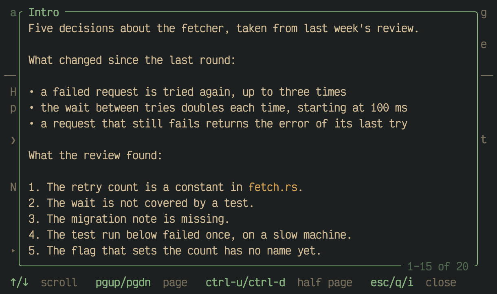

asqr draws a session as a stack of rows over the full width of the
terminal. This page names the parts of the screen from the top down.

1. **The title bar.** `asqr` in bold, then the session's title, or its
   id when it has no title. At the right end, dim, stand the queue and the
   number of sessions waiting, such as `default · 1 waiting`.
2. **The sender.** Under the title, a dim line says who sent the session
   (`from release script`) and, where the session names one, which earlier
   session it follows. A session that continues the draft of one it
   replaced adds a dim line of its own, `continues your draft of "<title>"`,
   with the id where the earlier session had no title. [Review, submit and come back
   later](01M68BT9BMFVCVEAACWR03B827-review-submit-and-come-back-later.md) says when that
   happens.
3. **The intro.** The session's introduction, at most two lines. A longer
   intro is cut and ends in `… i: more`, and `i` shows all of it.
4. **The tab bar.** One tab for every question, named by the question's
   `header`, or by its id when it has none. A tab shows `☒` once the
   question is answered and a dim `☐` while it is not. An info item
   shows a dim `ℹ`. The last tab is `✔ Review`. The tab you are on is
   bold, and the line under the bar is heavy under it and thin
   elsewhere. A default you have not touched counts as answered.
5. **The question.** Its text, kept to a reading width of 100 columns by
   default. Under it a dim hint says how to answer: "pick one", "pick up
   to 3 items", "type your answer", or on an info item "nothing to
   answer".
6. **The options.** The row under the cursor has a pointer, `❯`, and is
   filled. In a single choice the options show `( )` and `(•)`, in a
   multiple choice `[ ]` and `[x]`. The option's number is dim, its label
   bold and its description follows after the widest label. An option the
   asker recommends carries `◀ default` at the right end of its row. A
   question that allows your own answer has a last row that starts with
   `✎`.
7. **The notes line.** `Notes: —` under the options. `n` writes a note
   there.
8. **The status line.** The line above the key bar shows notices about the
   queue and messages about your last key, such as a refused action. They
   stay until your next key. While there is nothing to say it counts the
   sessions waiting in other queues that no asqr watches.
9. **The key bar.** The keys that work where the cursor is, each key bold
   and its action dim. The bar changes inside a field. Hints that do not
   fit the width are left out whole, and `?` and `q` stay longest.

## The whole intro

`i` shows the whole intro in a frame over the question. It renders
Markdown like every text of a session. When the intro is longer than the
frame, it scrolls with `↑`/`↓`, and the frame's bottom edge shows which
lines you see, such as `4–15 of 16`. `esc`, `q` or `i` close it. A session
without an intro ignores `i`.

