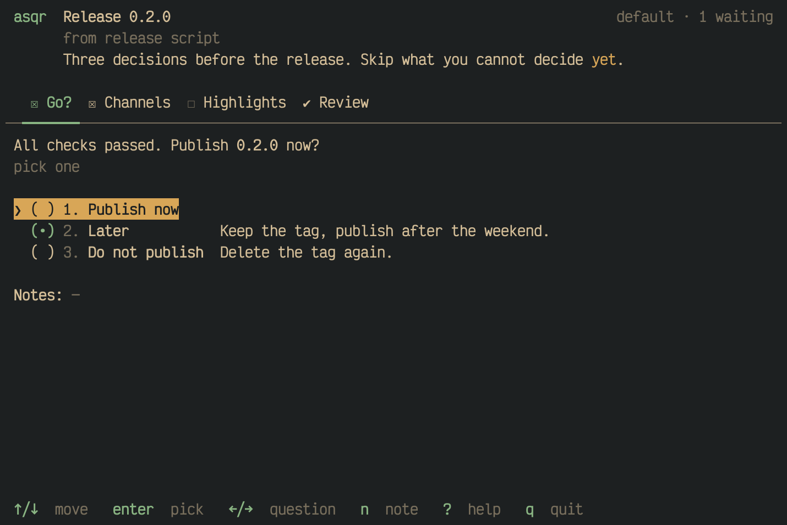
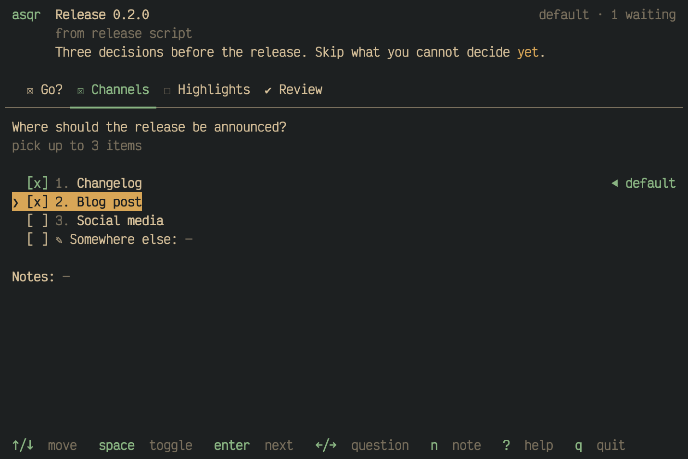
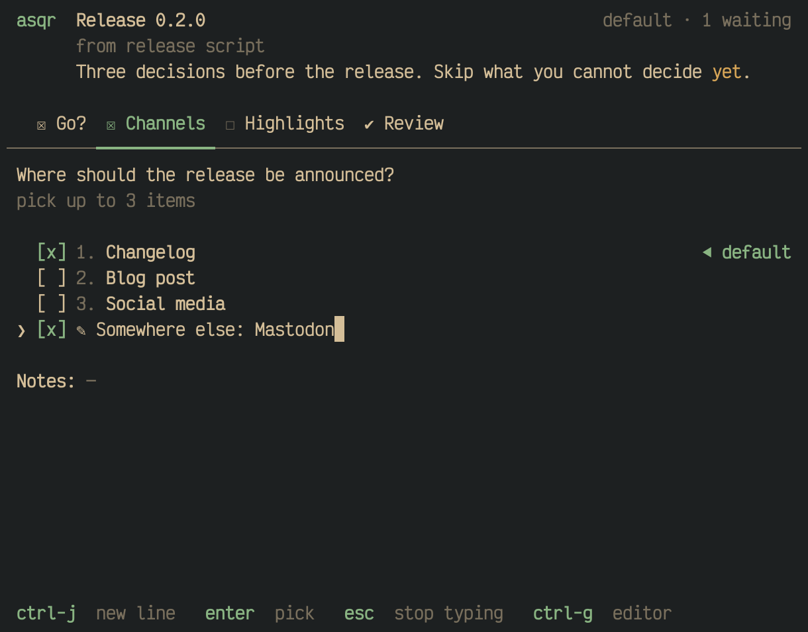
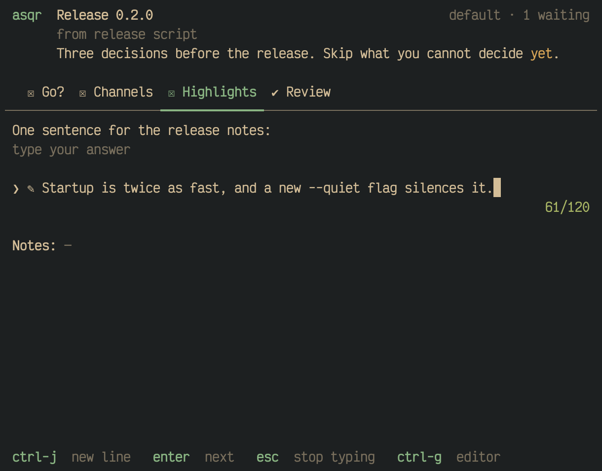
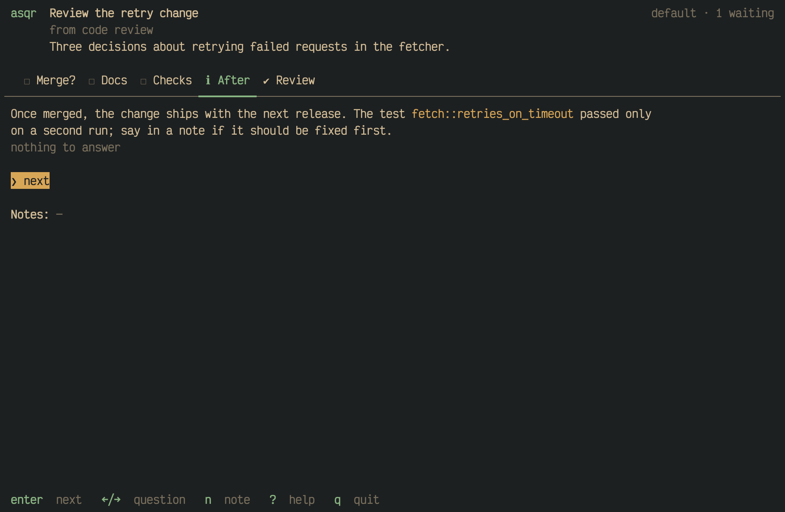
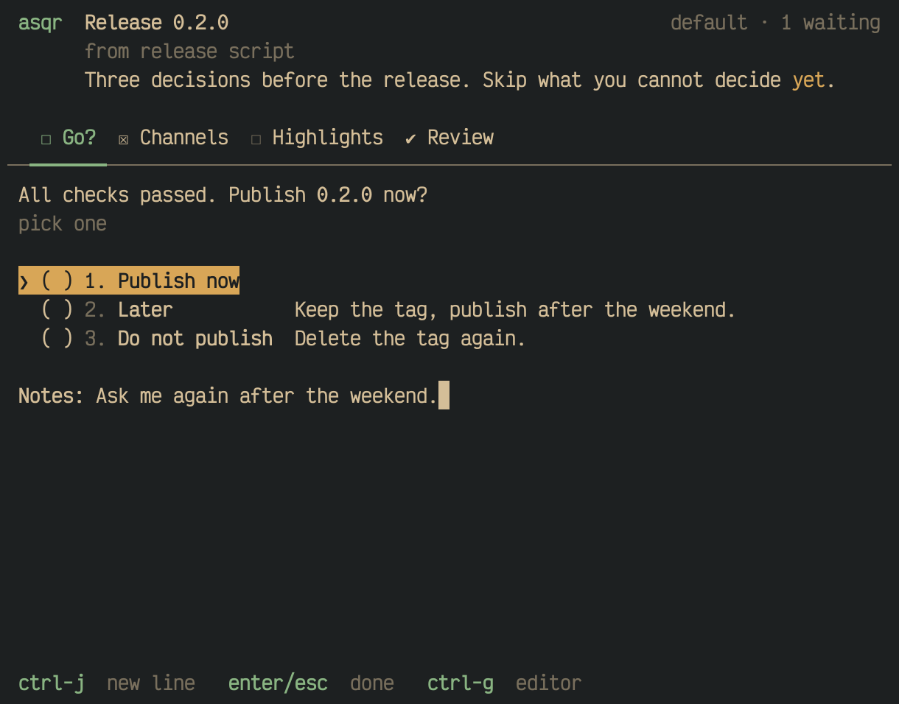

A session holds questions of four kinds. This page shows each of them,
and how defaults, your own answers and notes work.

## Single choice

You pick one option. `enter` picks the option under the cursor and moves
on to the next question. A digit from `1` to `9` picks that option and
moves on. `enter` on the option that is already picked keeps it picked.

`backspace` on the picked option's row clears the pick, a default
included. On any other row it does nothing, so moving around never clears
a pick.

## Multiple choice

You pick any number of options, within the limits the question sets. The
hint under the question names them: "pick between 2 and 3 items", "pick
at least 2 items", "pick up to 3 items", "pick 2 items" or "pick any".
`space` toggles the option under the cursor, a digit toggles that option,
and `enter` moves on. A selection beyond the upper limit is refused with
the message "at most N options".

An option marked `◀ default` is the asker's recommendation. It is checked
from the start, and a default you have not touched counts as answered.

## Your own answer

A question can allow an answer of your own. It is the last row, which
starts with `✎`. As soon as the cursor lands on it, every key that
produces text types into it. The mark in front of the row shows whether
your text counts. In a multiple choice it counts once it has text. In a
single choice `enter` picks it, and emptying the text is how you take
the pick back.

`esc` leaves the field and the cursor stays on the row. After that the
keys act as on any other row, so `n`, `q` and the rest are commands
again.

## Typed answer

A text question is one field that has the keys as soon as you reach it.
`enter` moves on. When the question sets a length, a counter at the right
edge shows how many characters you typed. The number after the slash is
the end of the target range the asker set. The counter reads `112/125`
within the target, `140/125 !` above it and `182/125 !!` above the
warning limit. A line break counts as one character. asqr never refuses
input because of the length.

## Info item

An info item shows a text and its context and asks nothing. Its hint reads
"nothing to answer", and it has one row, `next`, where `enter` moves on.
You can still write a note on it.

## Notes

`n` writes a note on the question you are on. The note shows on the
`Notes:` line under the options, and `enter` or `esc` finish it. Every
question and every info item takes one note, and the note goes to the
agent with your answers.

## Typing in fields

- `ctrl-j` adds a line. Every field takes several lines.
- `ctrl-g` opens the field in your editor, the program `VISUAL` names, or
  else `EDITOR`. While the editor runs, asqr does nothing else and ignores
  SIGINT. SIGTERM and SIGHUP quit asqr after the editor has ended.
- A paste goes in as a whole at the cursor, and a line break in it never
  picks, submits or rejects.
- Every edit is saved to a draft as you go. `q` leaves asqr and the draft
  keeps your answers.

The texts of a session, which are the intro, the question, the option
labels and their descriptions, are Markdown. asqr renders emphasis,
lists, quotes, tables, links and code blocks, which are highlighted when
the fence names a language.

[Every key](01M68AZYKWFPJAHTFZ0JPNNAK7-keys.md) is listed on one page.
