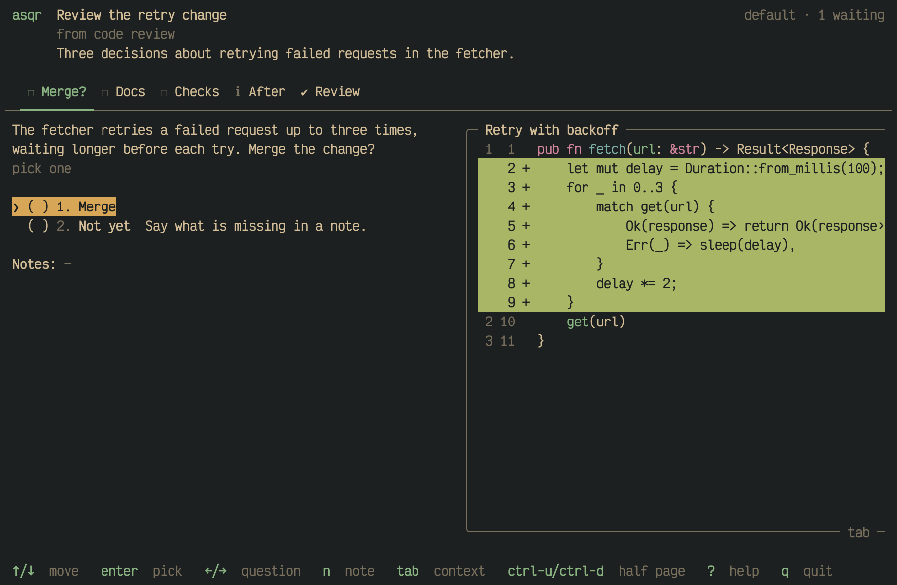

An asker can attach what you need to decide a question: a diff, a file, a
log or an image. asqr shows it in a pane of its own next to the question,
so you read it where you answer.

## What the pane shows

A question can carry context, and so can each of its options. The option
under the cursor shows its own context, so you can browse the options
before you pick one. Every other row, and an option without context of
its own, shows the question's context. A question without any context
shows no pane.

The space for the pane stays while the cursor moves, also when the current
row shows nothing, so the layout does not jump. asqr puts the pane beside
the question on a wide terminal and below it on a tall one.

## Reading it

- `pgup`/`pgdn` scroll the pane by a page and `ctrl-u`/`ctrl-d` by half a
  page, wherever the cursor is, also while you type in a field.
- `tab` moves into the pane. The arrow keys, or `j` and `k`, then scroll
  it by a line, and `tab`, `esc` or `q` give the focus back.
- `z` shows the pane's entry full screen, and `z` or `esc` go back.
- `o` opens the entry in the app your system has for its file type.
- `s` shows a diff side by side, and again in one column.

## What it can hold

An entry is a diff, a piece of code, Markdown, text in the colours of its
escape sequences or an image. [The context pane in
detail](01M68BT9BDTGM96WSRXRSYFZKY-the-context-pane-in-detail.md) shows
each of them, says where the pane goes and what asqr does with an entry it
cannot show.
