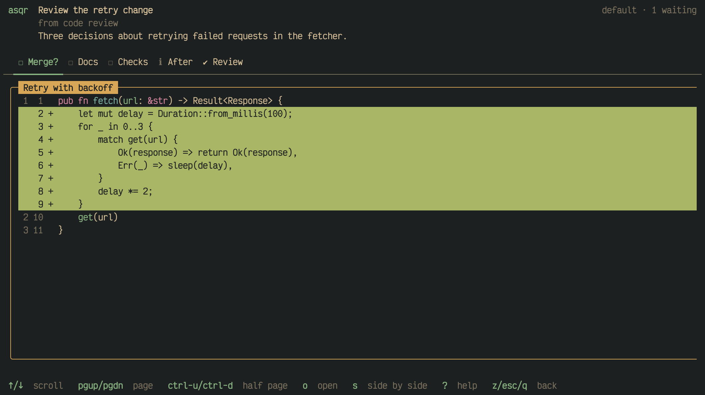
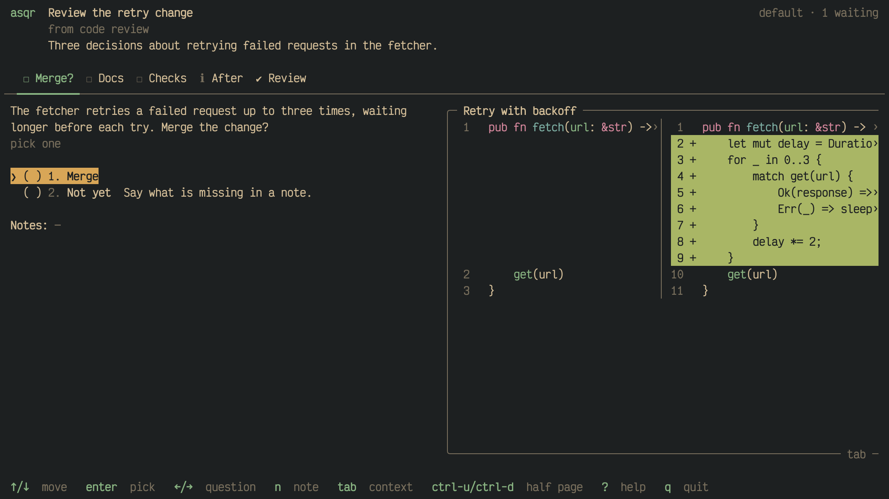
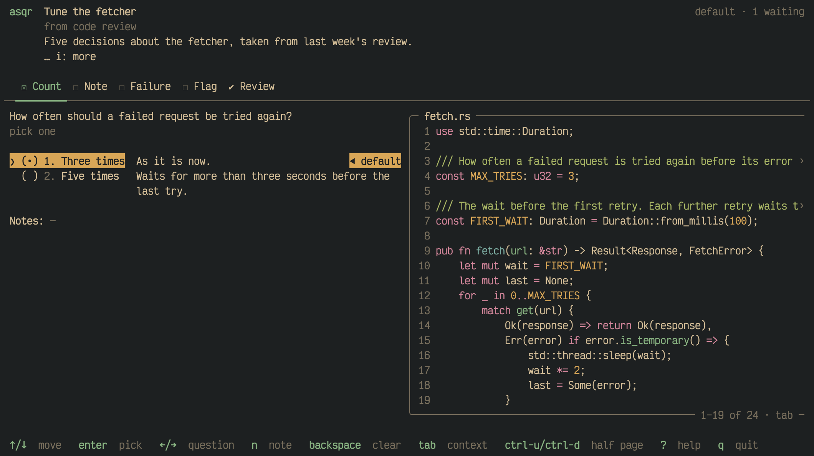
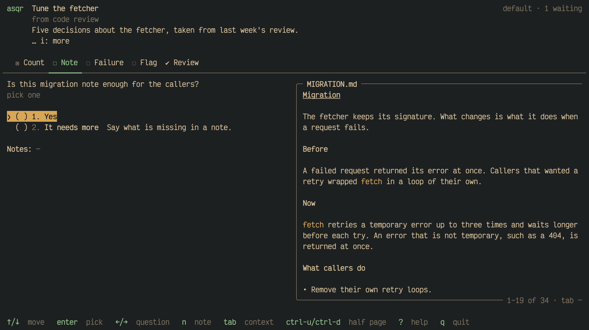
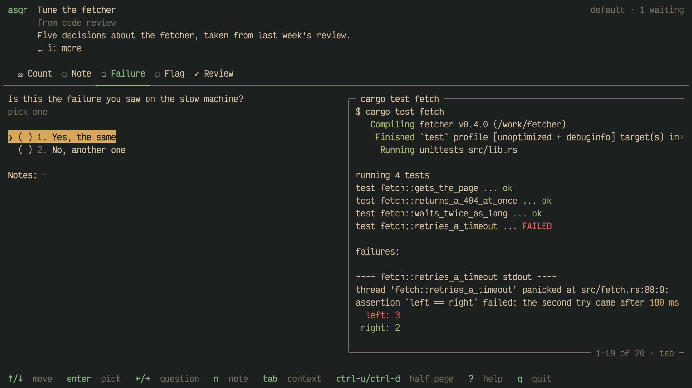
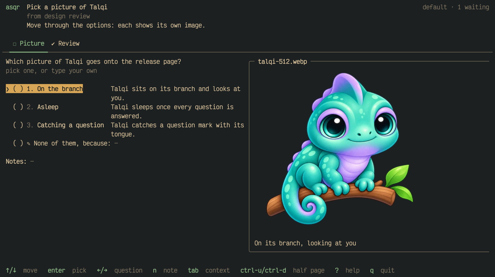

The material in the context pane is an entry. An entry is a diff, a piece
of code, Markdown, text in the colours of its escape sequences or an
image. This page shows how asqr draws each kind and what `z`, `o` and `s`
do with an entry.

## Full screen

`z` shows the entry of the pane over the whole area of the question. The
full-screen view takes every key, so `enter`, the digits and `n` cannot
reach the question behind it. It scrolls with the keys of the pane, and `z`,
`esc`, `tab` or `q` leave it.

## Diffs

asqr computes a diff from the old and the new text of the entry. It
shows the hunks, with 3 unchanged lines around each change, and the old
and the new line number in a dim gutter, followed by `-` for a removed
line and `+` for an added one. Removed lines have a red fill and added
lines a green one. The unchanged lines are highlighted in the language
of the diff.

`s` shows the diff in the other layout: side by side where it shows in
one column, and in one column where it shows side by side. A diff shows
first as the `diff_layout` setting says, in one column by default. The
switch holds while the entry shows. Side by side needs room for two
columns, and in a narrower pane the diff stays in one column.

## Code

A code entry shows its text exactly as written, highlighted in its
language, with the line numbers in a dim gutter. Without a language, or
with one asqr does not know, the text is plain.

Code, diffs and ansi text do not wrap. A line wider than the pane ends in
a dim `›`, and `←`/`→` or `h`/`l` scroll the pane sideways by 4 columns
while it has the focus.

## Markdown

A Markdown entry shows rendered, wrapped at the pane's width.

## Text with colours

An ansi entry holds text whose colour sequences set its colours and
attributes, such as the output of a command run with colours. asqr draws
it cell by cell and drops every other escape sequence.

## Images

Terminals that support the Kitty graphics protocol (Ghostty, kitty), the
iTerm2 protocol (iTerm2, WezTerm) or Sixel show an image inline. Other
terminals get a coarse rendering in blocks. Inside tmux, images reach the
terminal only when tmux passes escape sequences through: put
`set -g allow-passthrough all` into your tmux configuration. Without it
asqr shows images as coarse blocks.

## Open in another app

`o` opens the entry shown with the system's opener, `open` on macOS and
`xdg-open` elsewhere, so the app your system has for its file type shows
it. asqr stays on screen. An image, and a code or Markdown entry with a
file path, opens that file. Code or Markdown that came inline, and every
diff, is written to a file first. On an ansi entry `o` opens nothing.

## An entry asqr cannot show

When an entry's file cannot be shown, asqr draws a red card in the pane's
place. It names the reason and the file. The reason is one of the system's
or the image decoder's messages, or one of asqr's own: "relative path",
"not a regular file", "binary file" for a code, Markdown, ansi or diff
file that holds a NUL byte, or "image file larger than 64 MiB". A missing
or unreadable file gets a card too. A diff shows the card of the first side
that fails, with `old side: ` or `new side: ` before the reason.

`asqr validate` and `asqr ask` warn the agent about these files before you
meet the card: `cannot be shown:` and the card's reason for the files above,
"file not found" for a missing one.

## Slow entries

asqr reads and draws entries apart from the screen, so the keys keep
working. An entry that takes longer than 100 ms shows a dim `loading…`
in the pane until it is ready.
