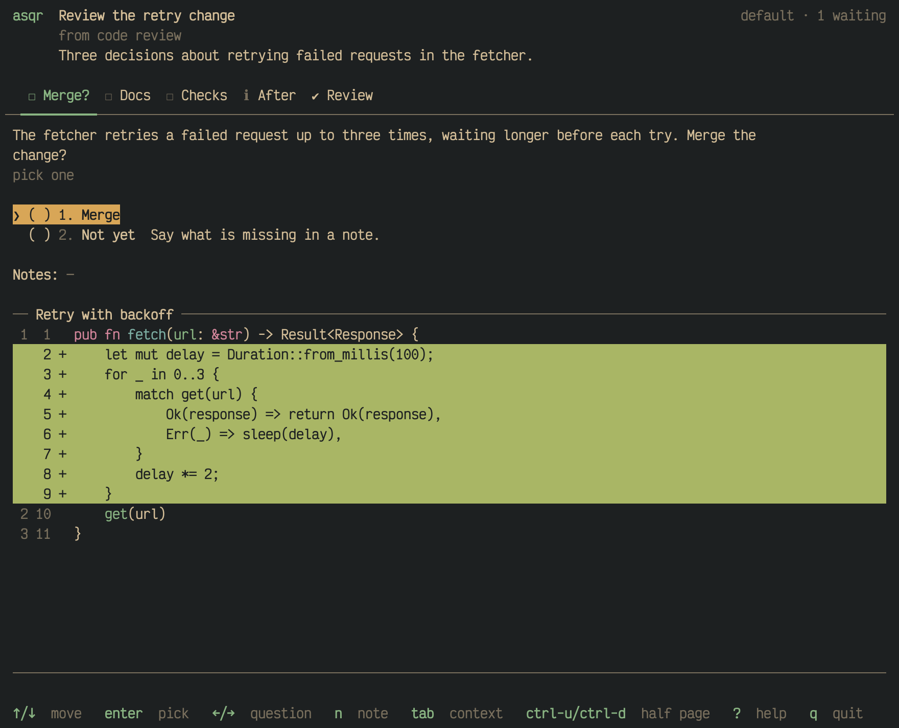
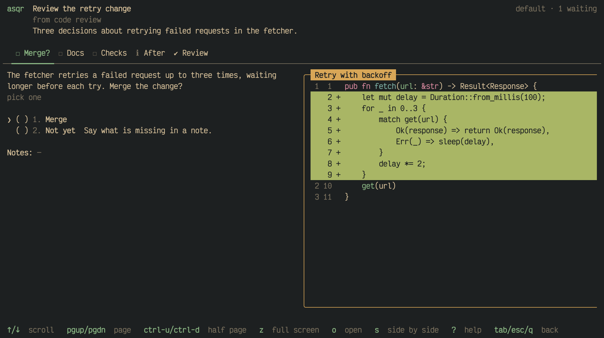

Details of [Context: files, diffs and
images](01M68BT9B5R7ASMVGW9SHK8MB2-context-files-diffs-and-images.md):
where the pane stands, its rules and focus, how asqr draws each kind of
entry, and what `z`, `o` and `s` do with it.

## Beside or below

asqr puts the pane beside the question on a wide terminal and below it on
a tall one. With the default setting, `auto`, the pane goes beside where
the area is landscape, which is where its width divided by twice its
height is at least 1, and below where it is portrait. A terminal of
120 by 40 or 230 by 60 gets the pane beside, and one of 110 by 70 or
90 by 50 gets it below. The pane fits beside on a terminal of 103 columns
or more, and below where the area under the tab bar has 15 rows or more.

You can fix the place. `--layout beside` or `--layout below` on the
command line, or the variable `ASQR_LAYOUT`, or the `context` key of
`settings.toml`, the `Context` row of the settings pane, does it. A flag wins over the variable and the variable
over the file. asqr uses the other place when only that one fits.

When neither place fits, the pane shrinks to one line at the bottom. It
names the entry and says `z: full screen`.

## The rules around the pane

The pane's first line is a rule with the entry's name in bold: its title,
or the file name of its path, or its kind when it has neither. The last
line is a rule too. When the entry is taller than the pane it says which
lines show, such as `1–20 of 53`, and it names `tab` when the entry is
taller or wider than the pane.

## Moving into the pane

`tab` or `shift-tab` moves the focus into the pane, also from a field. A
focused pane takes every key. The arrow keys, or `j` and `k`, scroll it
by a line, and the pane's name shows the focus fill while its rules turn
yellow. `tab`, `shift-tab`, `esc` or `q` give the focus back to where it
was.

The keys that scroll the pane without moving into it are on the page about
the [less obvious keys](01M68BT9BTS0J2VR1Y5N4NMEVC-less-obvious-keys.md).

## Full screen

`z` shows the entry of the pane over the whole area of the question. The
full-screen view takes every key, so `enter`, the digits and `n` cannot
reach the question behind it. It scrolls with the keys of the pane, and `z`,
`esc`, `tab` or `q` leave it.

## Diffs

asqr computes a diff from the old and the new text of the entry. It
shows the hunks, with 3 unchanged lines around each change, and the old
and the new line number in a dim gutter, followed by `-` for a removed
line and `+` for an added one. Removed lines have a red fill and added
lines a green one. The unchanged lines are highlighted in the language
of the diff.

`s` shows the diff in the other layout: side by side where it shows in
one column, and in one column where it shows side by side. A diff shows
first as the `diff_layout` setting says, in one column by default. The
switch holds while the entry shows. Side by side needs room for two
columns, and in a narrower pane the diff stays in one column.

## Code

A code entry shows its text exactly as written, highlighted in its
language, with the line numbers in a dim gutter. Without a language, or
with one asqr does not know, the text is plain.

Code, diffs and ansi text do not wrap. A line wider than the pane ends in
a dim `›`, and `←`/`→` or `h`/`l` scroll the pane sideways by 4 columns
while it has the focus.

## Markdown

A Markdown entry shows rendered, wrapped at the pane's width, as the texts
of a session render.

## Text with colours

An ansi entry holds text whose colour sequences set its colours and
attributes, such as the output of a command run with colours. asqr draws
it cell by cell and drops every other escape sequence.

## Images

Terminals that support the Kitty graphics protocol (Ghostty, kitty), the
iTerm2 protocol (iTerm2, WezTerm) or Sixel show an image inline. Other
terminals get a coarse rendering in blocks. Inside tmux, images reach the
terminal only when tmux passes escape sequences through, and without that
asqr shows images as coarse blocks.

> [!TIP]
> Inside tmux, put `set -g allow-passthrough all` into your tmux
> configuration, so images reach your terminal.

asqr scales an image to fill the pane as far as its proportions allow. An
entry the asker marked with `"enlarge": false` keeps its natural size and
only shrinks to fit. A caption shows under the image, after a blank row,
and the image takes the rows the caption leaves, so both always show
together. Where that leaves the image fewer than 3 rows, the pane shows the
caption alone under a dim `z shows the image`. `z` shows the image alone,
full screen.

## Open in another app

`o` opens the entry shown with the system's opener, `open` on macOS and
`xdg-open` elsewhere, so the app your system has for its file type shows
it. asqr stays on screen. An image, and a code or Markdown entry with a
file path, opens that file. Code or Markdown that came inline, and every
diff, is written to a file first. On an ansi entry `o` opens nothing.

## An entry asqr cannot show

When an entry's file cannot be shown, asqr draws a red card in the pane's
place. It names the reason and the file. The reason is one of the system's
or the image decoder's messages, or one of asqr's own: "relative path",
"not a regular file", "binary file" for a code, Markdown, ansi or diff
file that holds a NUL byte, or "image file larger than 64 MiB". A missing
or unreadable file gets a card too. A diff shows the card of the first side
that fails, with `old side: ` or `new side: ` before the reason.

`asqr validate` and `asqr ask` warn the agent about these files before you
meet the card: `cannot be shown:` and the card's reason for the files above,
"file not found" for a missing one.

## Large entries

asqr cuts a file after 8 MiB and a text after 500,000 lines, shows
Markdown above 1 MiB as plain text and stops highlighting after line
50,000. [Limits](01M68CASM4YTGM03NS3CKQS28G-limits.md) lists each limit and
the note asqr shows.

## Slow entries

asqr reads and draws entries apart from the screen, so the keys keep
working. An entry that takes longer than 100 ms shows a dim `loading…`
in the pane until it is ready.
