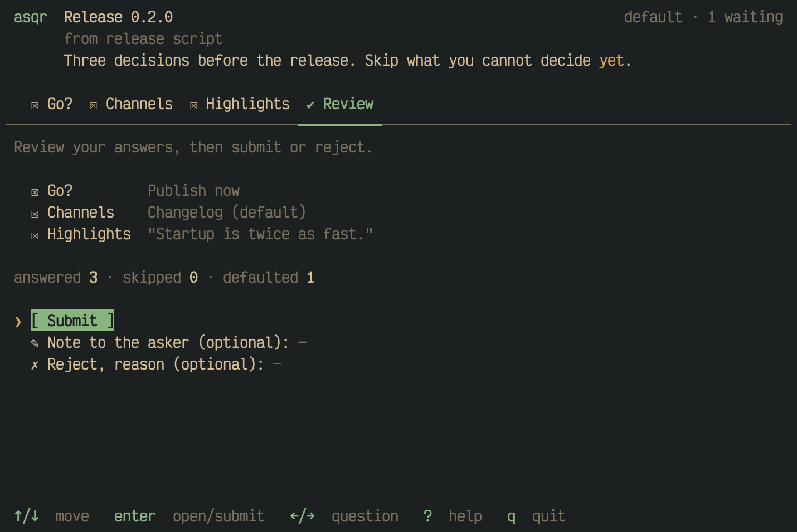
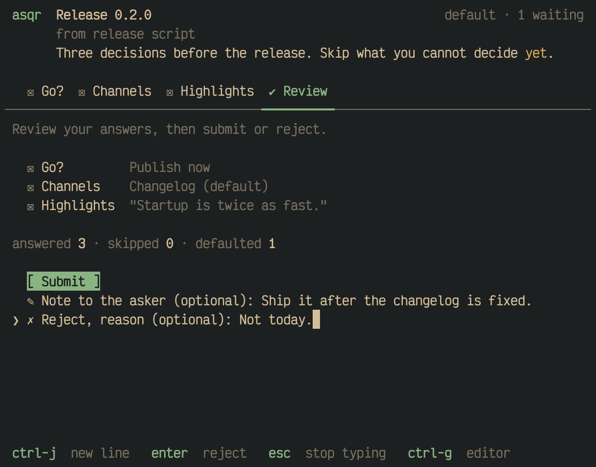
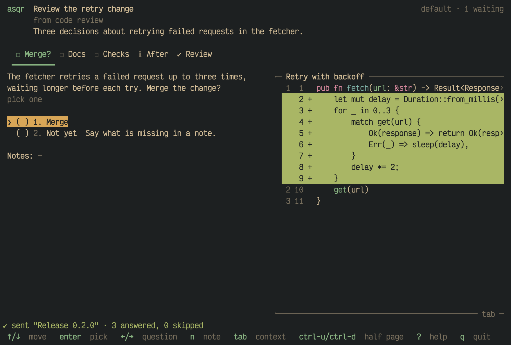
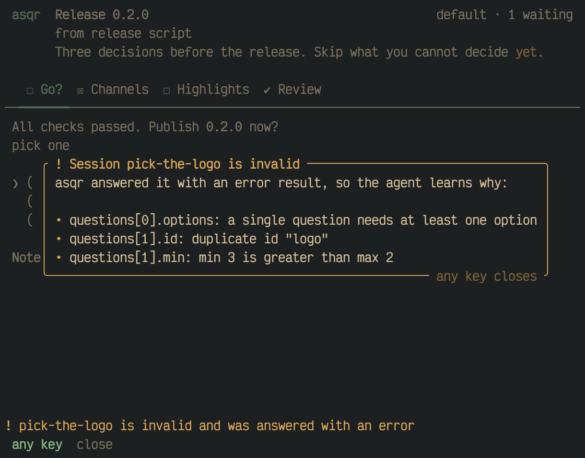
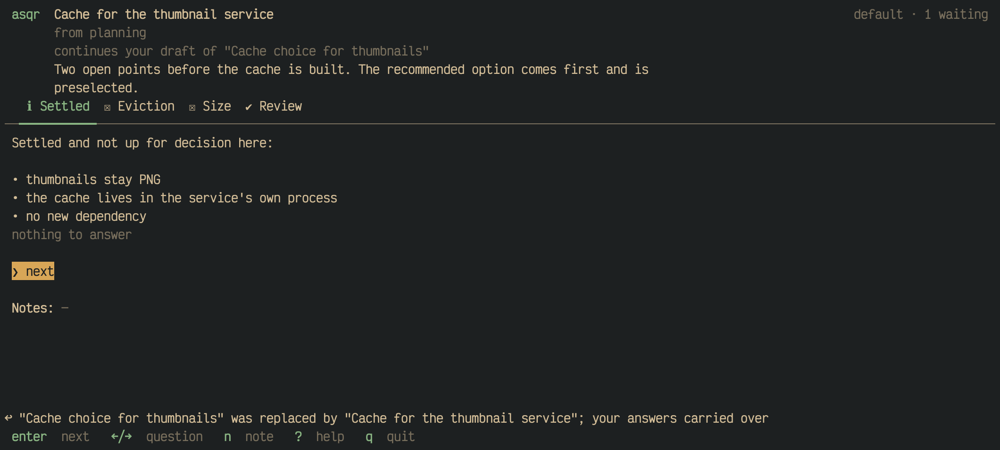

The last tab of a session is the review. You look at everything once,
then submit the answers or reject the session.

## The review tab

The review lists every question with its answer on one line, dim. A
single or multiple choice shows the labels of the chosen options. Your
own text and a typed answer show in quotes, with a line break shown as
`⏎`. `(default)` follows a default you did not touch, `-` stands for a
skipped question, and `+note` says the question has a note. Under the
list, the counts of answered, skipped and defaulted questions. Info items
are not counted.



`enter` on a question in the list moves to that question. The review
tab opens with the cursor on `[ Submit ]`, and the keys are commands
there.

## Submit or reject

- `[ Submit ]`: `enter` submits the session.
- **Note to the asker**: a field for an optional note to the whole
  session. `enter` in it submits the session with that note.
- **Reject**: a field for an optional reason. `enter` in it rejects the
  session. The result keeps the session note and the questions that have
  an answer or a note.

There is no `n` on the review tab.



## What happens next

The session leaves the screen. The next session in the queue takes over,
or the one before it when it was the last, or the empty screen when none
is left. The status line confirms what asqr wrote and names the session
by its title, or by its id when it has none:

```
✔ sent "Release 0.2.0" · 1 answered, 2 skipped
✗ rejected "Release 0.2.0"
```

The counts are those the review showed, a default counted as answered.
The notice stays until your next key, also over the next session.



A submit that does not finish keeps the session and shows a notice of its
own. One such case is a session file that changed on disk after you
opened it: asqr does not send the answers, and loads the new version so
that you see it before you answer.

## Leaving without submitting

`q` quits asqr and keeps your answers. asqr writes them to a draft every
time they change while the session waits, and when it shows the session
again it restores them. It matches the answers by question and option, and
drops what no longer fits the session.

## When a session is invalid

A session file that fails validation never reaches the questions. asqr
answers the asker with an error result that names the problem, and shows
you a dialog. The dialog is framed in the warning colour. Its title names the session, and each
problem stands on a line of its own behind a `•`. Any key closes the dialog,
and it does nothing else.



The dialog also shows when no session is waiting.

## When the asker takes a session back

An asker can take a waiting session back with `asqr withdraw`. A session
you had on screen, or had entered answers into, leaves with a notice in the
status line:

- `↩ withdrawn "Release 0.2.0" by the asker`,
- `! ↩ withdrawn "Release 0.2.0" by the asker, with your answers so far`
  when what you entered went to the asker in the result,
- `! ↩ withdrawn "Release 0.2.0" by the asker; your answers to it are
  dropped` when asqr held answers that the result does not carry.

A session that only waited in the queue leaves without a word.

## When the asker replaces a session

`asqr ask --replaces <id>` withdraws a waiting session and drops a reworked
one in its place. asqr carries your draft over into the new session. It
matches your picks, typed text, notes, the note to the asker, the reject
reason and the question you were on to the new file by question id and
option id. A question the asker keeps under its id keeps what you entered,
and one under a new id starts fresh. An answer whose picked option or own
text has no place in the new file is dropped, and that question takes the
defaults of the new file.

The header of the new session says that it continues your draft. If you had
the old session open, it leaves with an information notice in place of the
withdrawn notices above, which names both sessions.


