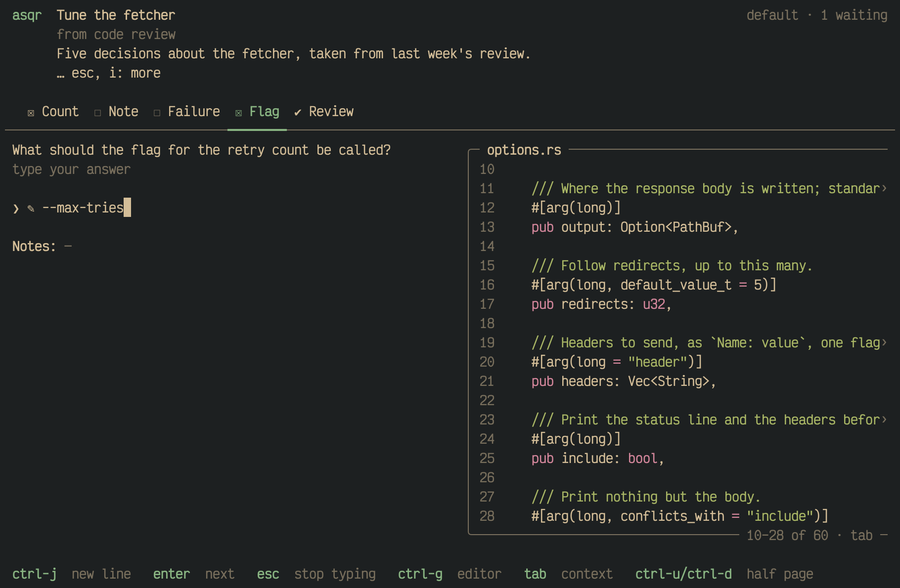
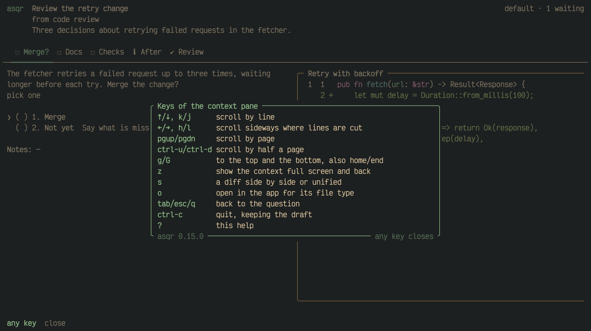
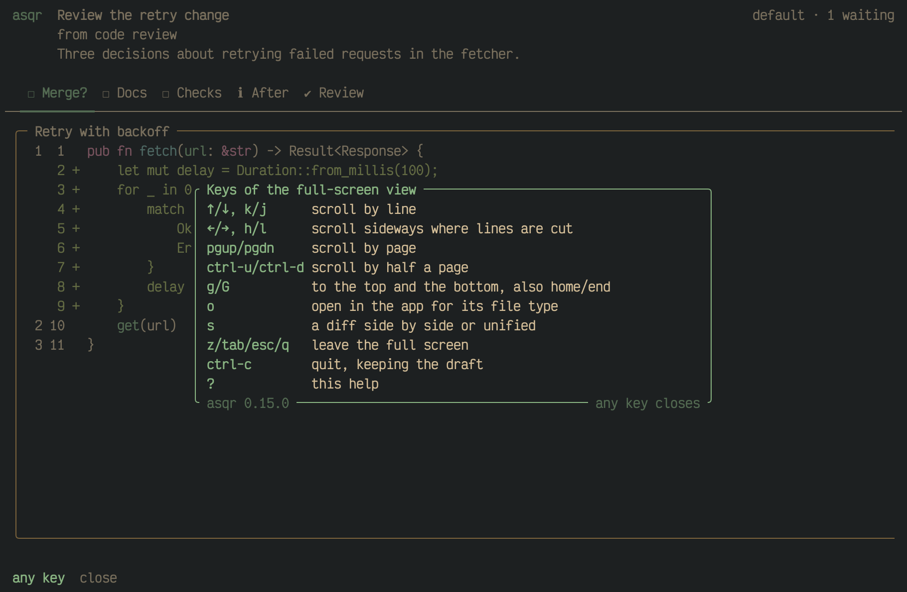

Most keys do what the key bar says. These do more than it shows, or act
differently depending on where the cursor is.

## Paging the pane from anywhere

`pgup` and `pgdn` scroll the context pane by a page less 2 lines.
`ctrl-u` and `ctrl-d` scroll it by half a page. They work while a pane
shows, wherever the cursor is, also in the middle of typing in a field.
The two lines at the edge of a page show again at the other end, so you
keep your place. Half a page is half the height of the pane, rounded
down, and at least one line.

The keys that scroll by a line, `↑`/`↓` and `j`/`k`, the sideways keys
`←`/`→` and `h`/`l`, and `g`/`G` and `home`/`end` only scroll a pane that
has the focus. On the question they move the cursor or type.

Without a pane, nothing is scrolled. In a field `pgup` and `pgdn` then do
nothing, `ctrl-u` undoes your last edit and `ctrl-d` deletes the character
under the cursor.

## Into the pane and out again

`tab` and `shift-tab` move into the pane from anywhere a pane shows, also
from a field, and never type into it. In the pane, `tab`, `shift-tab`,
`esc` and `q` give the focus back to where it was, even to a field you
were typing in. That is why `q` does not quit asqr there: a word you type
after `tab` cannot close it by accident.

`?` shows the keys that work where you are. Over the pane it lists the
pane's keys, and over the full-screen view it is titled "Keys of the
full-screen view".

## Fields

A field takes every key that produces text, so `n`, `q` and `w` type
there. `esc` leaves the field, the cursor stays on the row, and the
letters are commands again. `ctrl-g` opens the field in your editor, and
`ctrl-j` adds a line.

`←` at the start of the text goes to the previous question and `→` at its
end goes to the next one, so you can leave a field sideways without
`esc`. `↑` leaves a field from its first row and `↓` from its last.
