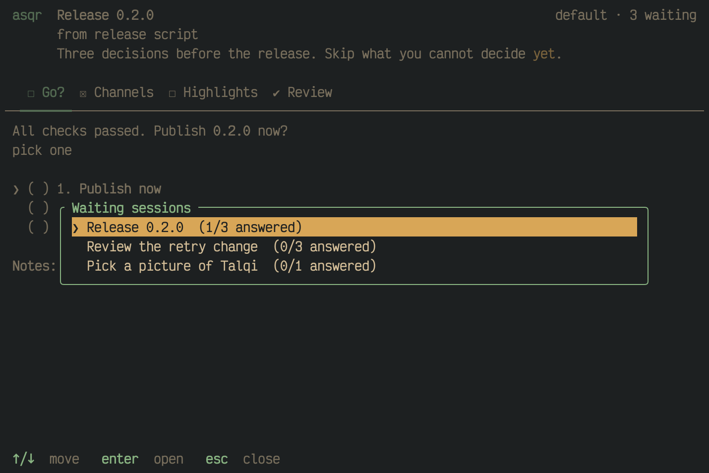
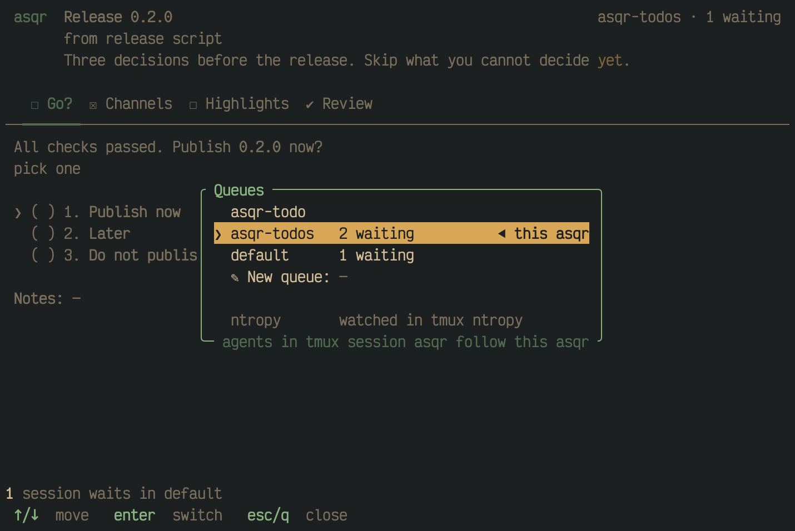
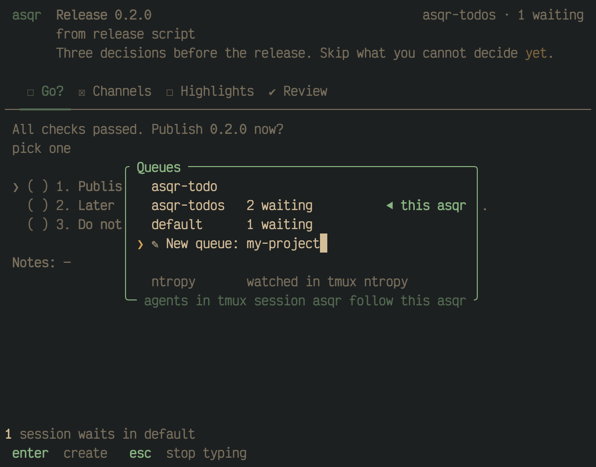
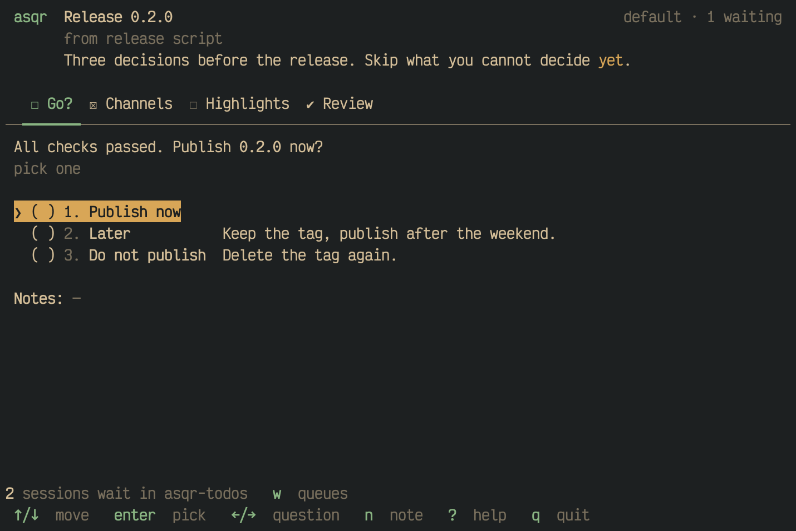
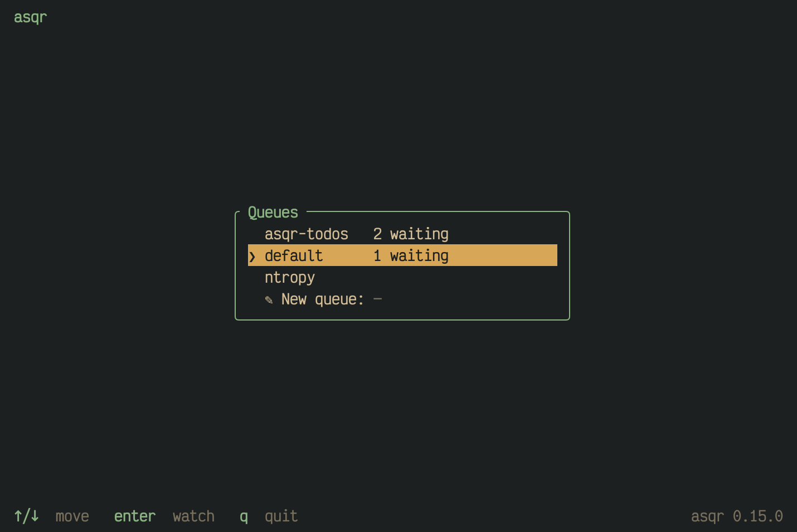

Sessions wait in a queue. A queue is a directory with an inbox for the
sessions, an outbox for the results, a place for drafts and an archive.
One asqr watches one queue. This page covers choosing the queue, moving
between queues and the lists asqr shows about them.

## Which queue

The default queue lives in the platform's data directory, in
`~/Library/Application Support/asqr/` on macOS and
`$XDG_DATA_HOME/asqr/` on Linux, usually `~/.local/share/asqr/`.
`asqr paths` prints where the queue and its files are.

- `--queue <name>` or `ASQR_QUEUE` picks a named queue under that
  directory, which keeps the questions of projects apart.
- `--dir <path>` or `ASQR_DIR` names the queue directory itself, the one
  with `inbox/` inside.
- A flag wins over a variable, and a variable wins over the tmux session
  and the default.
- An empty variable counts as unset, and so does one whose value is not
  UTF-8.

A queue given by `--dir` or `ASQR_DIR` is named by its absolute path, with
`~` for your home folder: on the waiting screen, in the title bar, in the
terminal title, in the queue switcher and in the status line after a
switch. The switcher's footer tells your agents that path written for a
shell.

`asqr ask`, `asqr wait` and the other commands take the same flags and
variables.

## Inside tmux

Inside tmux, asqr and the agents of the same tmux session use one queue
without any setup. It is the queue asqr pinned in that session, and at
first the queue named after the session, so several tmux sessions keep
their questions apart. `asqr --queue <name>` pins another queue in the
session. `asqr queues` lists every queue with its waiting and answered
sessions and the asqr that watches it, with that asqr's tmux session.

## The sessions waiting

`L` opens the list of the sessions waiting in the queue, in queue order,
each with how many of its questions are answered. `↑`/`↓` or `k`/`j`
move, `enter` switches to the session, and `esc` or `L` close the list.

## Moving to another queue

`w` opens the queue switcher, so you can change the queue without a
restart. It lists the queues asqr can switch to, sorted by name, with
`default` among them. A queue with waiting sessions shows `N waiting`,
and the queue this asqr watches ends in `◀ this asqr`. A queue given by
`--dir` stands first. Queues that another asqr watches follow below a blank row, dim,
with `watched in tmux <session>`, and the cursor never reaches them.

`↑`/`↓` or `k`/`j` move, `enter` switches to the queue under the cursor,
and `esc`, `q` or `w` close the switcher. The footer on the frame's bottom
edge says what a switch means for the agents. Inside tmux it reads
`agents in tmux session <name> follow this asqr`. Outside tmux it reads
`tell your agents: --queue <name>`.

The last row the cursor reaches is `✎ New queue`. It is a field as soon as
the cursor stands on it: letters, digits, `-`, `_` and `.` type there,
and `enter` with a name switches to a new queue of that name. A name does
not start with a `.`.

When you switch, asqr saves the draft of every session of the old queue
that holds an answer, and only then lets go of the old queue. The status
line says what came of it, such as `watching default · 2 sessions wait in
asqr-todos`. In a field `w` types, and the focused pane takes it.

## Other queues with waiting sessions

While asqr has nothing to say, the status line counts the sessions
waiting in named queues that no asqr watches, such as
`2 sessions wait in asqr-todos   w  queues`. It never rings or notifies,
as several queues can be fine. asqr looks at the other queues when it
starts, when the switcher closes and every 5 seconds.

## The start picker

Outside tmux, when no flag or variable chose a queue, and when there is a
queue besides `default` that no other asqr watches, asqr asks which queue
to watch before it starts. The picker is the switcher's list under a title
line that reads `asqr`. `↑`/`↓` move, `enter` watches the queue under the
cursor and `q` quits. While the new-queue row has the keys, the key bar reads
`enter  create   esc  stop typing`. A queue that another asqr took in the
meantime, or one asqr cannot watch or read, leaves the picker open with the
notice of a failed switch in its status line. The first-start screen, where
it shows, comes before the picker.

On a terminal smaller than 60 columns by 15 rows the picker shows the
message that asqr needs at least that size, as the session screen does.
Under `NO_COLOR` it draws without colours and keeps bold and dim.

