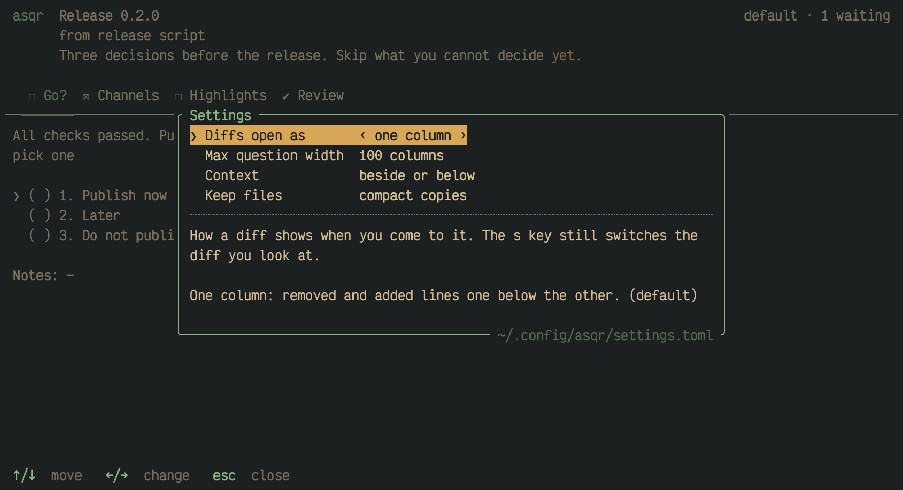
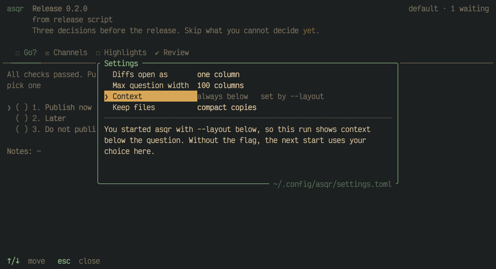

asqr has three settings. You change them in asqr with `,`, and asqr keeps
them in a file.

## The settings pane

`,` opens the settings pane over the question or over the empty queue. It
has one row for each setting. The row under the cursor shows its value
between `‹` and `›`. `↑`/`↓` or `k`/`j` move between the rows, and `←`/`→`
or `h`/`l` change the value of the row. A change is saved at once and wraps
around at the ends of the values. `esc`, `q` or `,` close the pane. In a
field `,` types, and the focused pane takes it.



The text under the dotted rule always explains the row under the cursor:
what the setting does and what its value means.

| Setting | What it does | Values |
|---|---|---|
| `Diffs open as` | How a diff shows when you come to it. `s` still switches the diff you look at. | `one column` (default), `side by side` |
| `Max question width` | The widest a question's text gets. A narrower terminal gets a narrower text. | `80 columns`, `100 columns` (default), `120 columns`, `full width` |
| `Context` | Where the files, images and diffs that come with a question show. | `beside or below` (default), `always beside`, `always below` |

A change applies at once. The question's width and the place of the context
change from the next draw. The layout diffs open in changes for every
session, except for a diff you switched with `s`, which keeps its layout.

After a change the status line says what came of the save:

```
✔ saved diffs open as: side by side
✗ cannot save the setting: <reason>; the choice holds until asqr quits
```

In the second case the choice stays in effect for this run and the file
does not have it.

## A setting a flag or a variable holds

`--layout` and `ASQR_LAYOUT` hold the `Context` setting. Its row then shows
the value in effect, dim, with `set by --layout` or `set by ASQR_LAYOUT`
beside it, and `←`/`→` do nothing there. The text under the rule says what
holds the row and what to do.



## The settings file

asqr keeps the settings in `settings.toml` in the platform's config
directory: `~/Library/Application Support/asqr/settings.toml` on macOS and
`$XDG_CONFIG_HOME/asqr/settings.toml` on Linux, usually
`~/.config/asqr/settings.toml`. The frame of the pane names the file on its
bottom edge, and `asqr paths` names it too. It is a TOML file, and every
key may be left out:

| Key | Values | Default |
|---|---|---|
| `diff_layout` | `"unified"`, `"side-by-side"` | `"unified"` |
| `max_question_width` | `80`, `100`, `120`, `"full"` | `100` |
| `context` | `"auto"`, `"beside"`, `"below"` | `"auto"` |

A flag wins over a variable, a variable over the file and the file over the
default. Only `context` has a flag and a variable.

The pane writes only the key it changes. It reads the file again before
each write, so a change you made in an editor stays, and the file keeps its
comments and the keys asqr does not know. asqr never writes over a file it
cannot parse, or one nobody may write to.

A file that is not there gives every default. A file asqr cannot read, or
cannot parse, gives every default as well, with a warning in the log. The
status line shows the warning when asqr starts, unless a notice shows
already. A key with a value that is none of the listed ones costs only that
setting, which takes its default.
