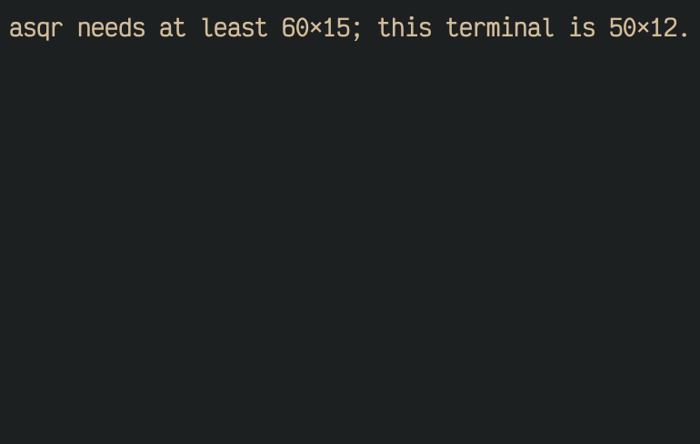

asqr uses what your terminal offers to tell you that a session arrived and
how far you are. This page lists what it sends and what tmux has to allow.

## A new session

A new session triggers a desktop notification and a terminal bell. The
notification is an escape sequence, OSC 9 or OSC 777, which terminals such
as Ghostty, iTerm2 and kitty show. It names the session, or counts them
when several arrive at once. `--no-notify` and `--no-bell` switch them
off. Sessions that wait when asqr starts, and session files that are
replaced, trigger nothing.

## The terminal title

The terminal title reads `asqr · 2 waiting` and changes with the count.
For any queue but the default it names the queue too, as
`asqr · asqr-todos · 2 waiting`. When asqr quits, it resets the title, and
a terminal with a title stack shows its earlier title again. `--no-title`
switches the title off, and asqr then writes none of these sequences.

## Progress

Some terminals show how much of the session in front of you has an answer:
Ghostty from 1.2.0 and iTerm2 from 3.6.6 as a bar in the window, Windows
Terminal as a ring on the tab, and kitty from 0.39.0 inside tmux as a
percentage in the tab's title. The share is the percentage of the
questions that have an answer, rounded down. An untouched default counts
as answered, and info items count neither way. Every other terminal gets
nothing, as several show any OSC 9 as a desktop notification. GNU screen (a
`TERM` starting with `screen`) and Zellij get nothing either, whatever else
is set. A terminal that sets `TERM_PROGRAM` is judged by it alone. Where it is
unset, `LC_TERMINAL=iTerm2` counts as iTerm2 with the version in
`LC_TERMINAL_VERSION`, and `WT_SESSION` counts as Windows Terminal.

## Inside tmux

Images and desktop notifications only reach the terminal around tmux when
tmux passes escape sequences through. Put this into your tmux
configuration:

```
set -g allow-passthrough all
```

Without it asqr shows images as coarse blocks and rings the bell instead
of sending a notification. With `on` instead of `all`, tmux drops what asqr
sends while its window is in the background, and an image that arrives
then stays empty until asqr gets the focus again, which it only learns
from tmux with `set -g focus-events on`. In kitty and Ghostty, with tmux
3.4 or later, asqr sets `all` for its own pane while it runs and puts the
pane's setting back when it quits.

## Size and colours

asqr needs a terminal of at least 60 columns by 15 rows. A smaller one
shows a message in place of the screen.



Under `NO_COLOR` asqr draws without colours. Text, marks, pointers, bold,
dim and reversed text stay, so the screen says the same as with colours.

Talqi on the empty queue shows on terminals of at least 32 rows and 44
columns.
