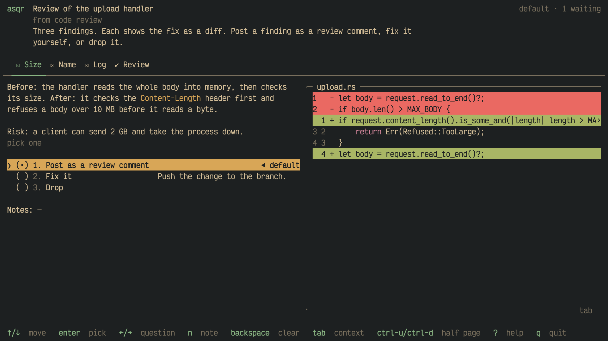
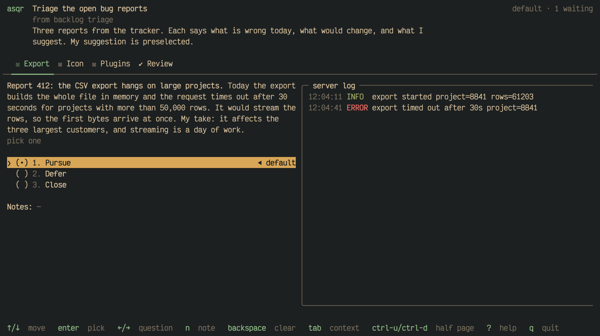

Your agent can put any set of questions in front of you through asqr: the
decisions before it starts, what to do about review findings, which of
several drafts to keep. This page shows how to ask for a session and what
such sessions look like.

## How to ask

Tell your agent what to ask about and that it should use asqr, in your own
words:

- "Before you implement this, use asqr to ask me the open decisions."
- "Go through the review findings and ask me through asqr what to do about
  each."
- "Use asqr to ask me which of the icon drafts to keep."

Your agent uses asqr only when you ask it to. The bundled skill suggests
what a session can hold for a kind of task. These patterns are a starting
point: an agent adapts them, combines them or leaves them aside. They never
make a task a reason to use asqr without your request.

## Decide before implementing

One question for each open point. What the agent settled that bears on
several questions, and that you need to know, comes in short info items
just before the questions it bears on, or first where it bears on none. The recommended option stands first and is the default. Each option
has a short trade-off as its description, and the current state or the
option's own diff is the context.

Here the context changes as the cursor moves between the options, so you
see what each choice would do.

## Review findings

One question for each finding. Its text gives the code before and after in
two sentences, and the risk. The context is the fix as a diff with a name,
which highlights the unchanged lines. The options are such as post as a
review comment, fix, or drop.

## Triage a backlog

One question for each item of bug reports, todos or updates. Its text says
in a sentence or two what is wrong or missing today and what would change,
for a person who has not read the item, then the agent's take and fix
idea. The strongest evidence, such as a log or a screenshot, goes into the
context. The options are such as pursue, defer or close, and the agent's
recommendation is the default.

## Compare visual variants

One question for each thing to decide, such as each icon. Each variant is
an option with a short label, its image as the context and a one-line
caption on what sets it apart. You pick one, or every one worth keeping.

As the cursor moves between the options, the pane shows each option's
image.

## More patterns

The skill describes more: picking candidates inside a pipeline, walking
through a debug, restructuring a document and a rating grid. `asqr skill
patterns` prints all of them.
