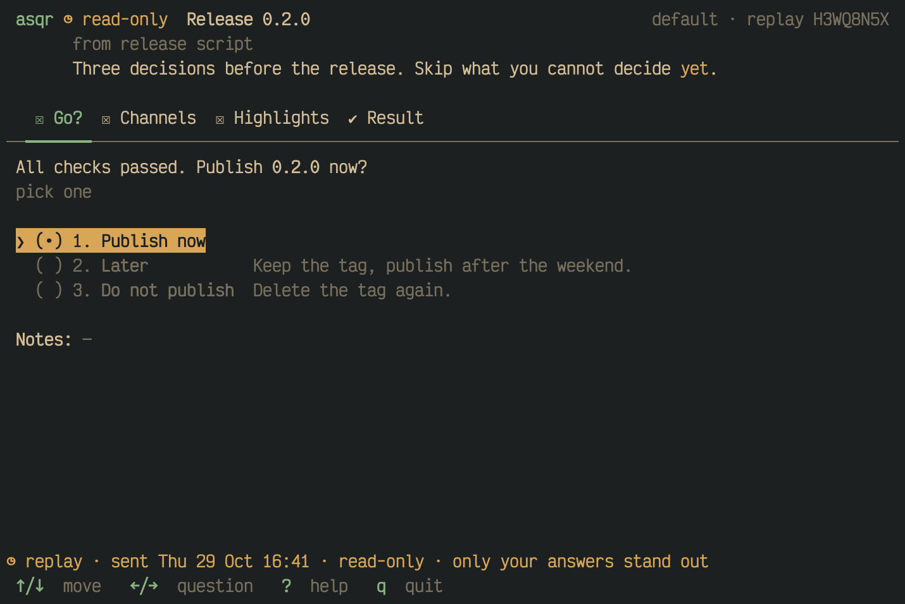
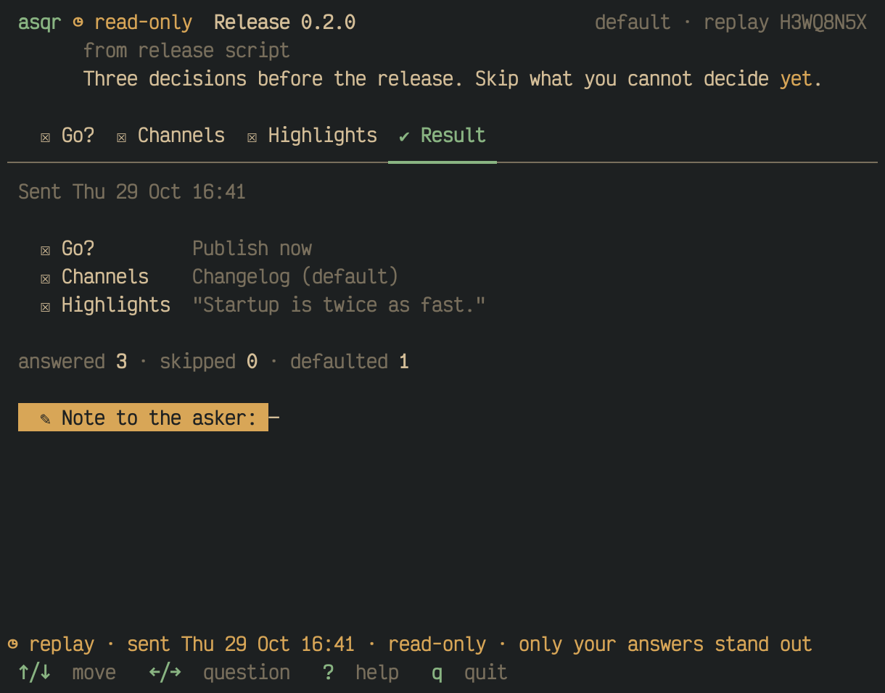
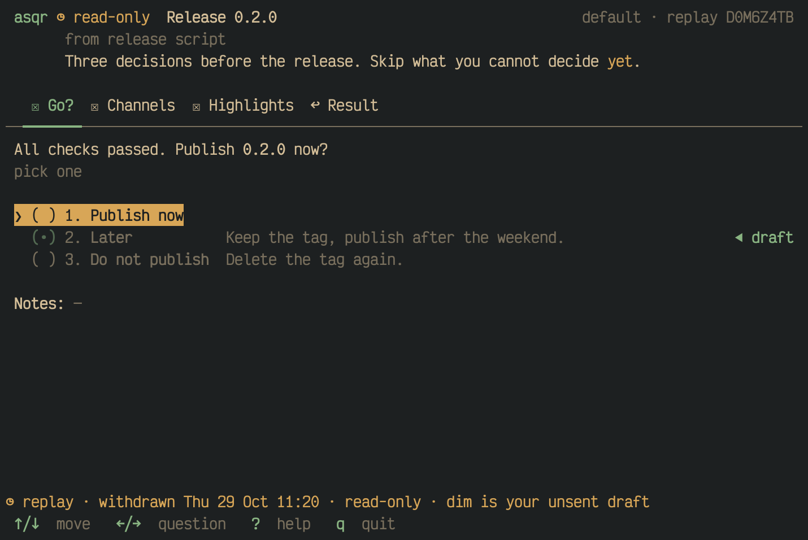
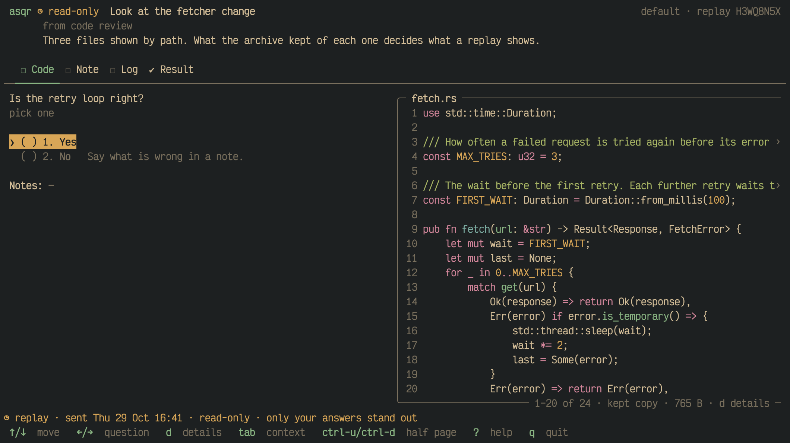
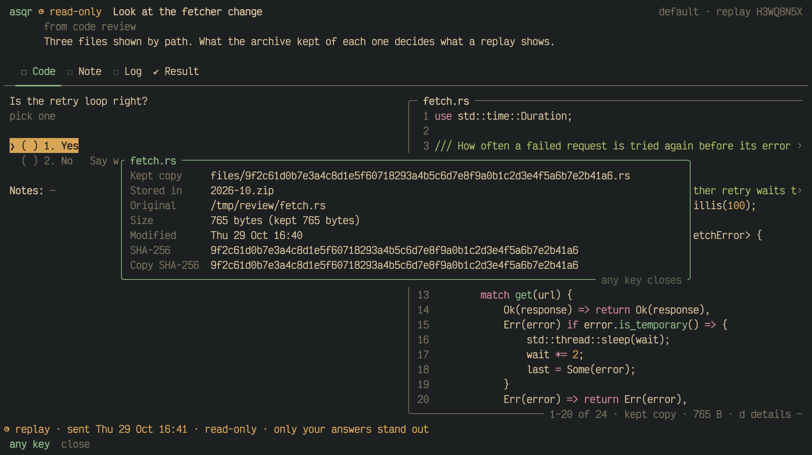
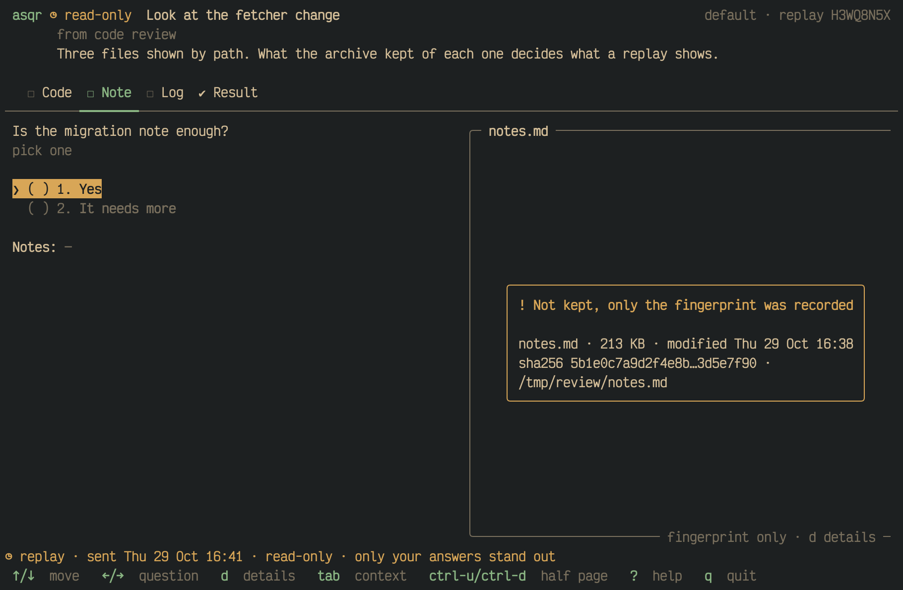
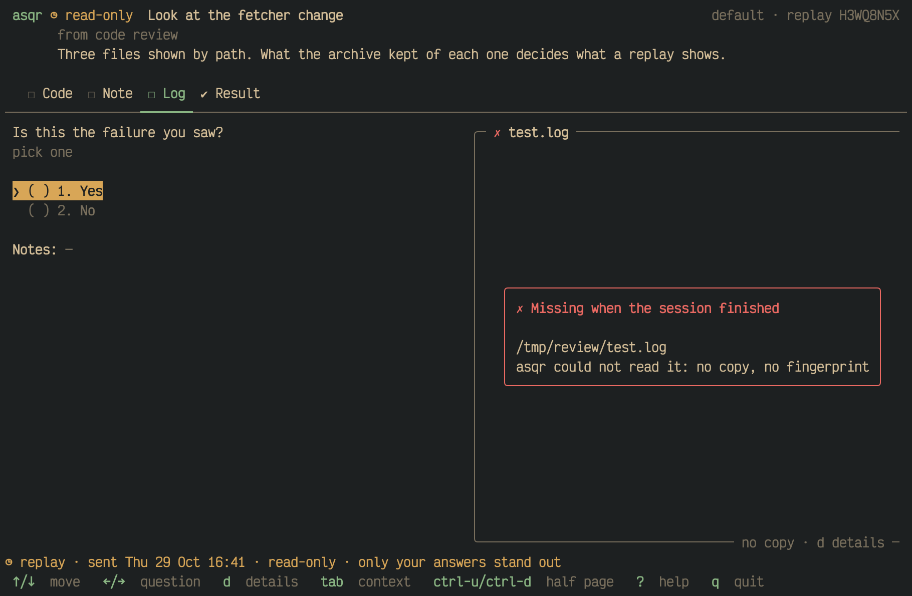

A finished session stays in the queue's archive. `asqr history` lists the
finished sessions, and `asqr replay` opens one of them again, read-only,
with your answers filled in and the files it showed.

## The list

`asqr history` lists the finished sessions of the queue, newest first:

```
queue: default
finished (10 of 52):
REF       WHEN          STATUS      FILES        TITLE
H3WQ8N5X  30 Oct 09:14  sent        -            Release 0.2.0
D0M6Z4TB  29 Oct 11:20  withdrawn*  1 of 2 gone  Migration plan: drop legacy tables

* withdrawn by the asker; the answers you had entered are kept as a draft

Open one with: asqr replay <REF>
```

- `REF` is the last 8 characters of the ULID in the archive name of the
  session. Session ids repeat and the ULID does not, so the reference and
  not the id names an entry.
- `WHEN` is the time the result was finished, in your local time zone. A
  session without a result shows the time it was archived.
- `STATUS` is `sent` for a submitted session, `rejected`, `error`,
  `withdrawn` or `no result`. `withdrawn*` is a withdrawn session whose
  result carries an unsent draft of your answers.
- `FILES` counts the files the session recorded: `3 kept`, `1 of 2 gone`
  for files that were missing or unreadable when you finished the session,
  `2 not kept`, and `-` for a session that shows or records none.
- `TITLE` is the session's title, or its id without one. A control
  character in a title is printed as U+FFFD, so a title cannot move the
  cursor or change the terminal.

`--limit <count>` lists at most that many sessions, 10 by default. `--since
<age>` keeps the sessions archived within an age such as `2d` or `3w`.
`--all` lists the finished sessions of every queue under the data
directory, one block for each queue, and `--limit` and `--since` then
apply to each queue. `--json` prints the list as JSON. A month bundle that
cannot be read gives a `warning:` line on stderr, and the other sessions
are listed. `history` ends with 0, 1 or 2 only: how a session ended shows
in its row and never as an exit code from 10 to 14.

## Opening one

`asqr replay <REF>` opens the session with that reference. The reference
is the one `history` prints. Six or more of its characters are accepted,
in any case.

- asqr looks for the reference in the default queue and in every named
  queue under the data directory, and in the queue `--dir` names.
- A reference that ends several sessions exits with 1 and lists them, with
  their reference, queue, the time they were archived and their title, so
  that a longer reference can name one. A reference that ends none exits
  with 1 too. One of fewer than 6 or more than 8 characters, or with a
  letter no ULID holds (`I`, `L`, `O`, `U`), is a usage error, exit code 2.
  These errors start with `error: ` like those of every other command.
- A session file that does not parse or validate, and a bundle that
  cannot be read, end the replay with an error and exit code 1. Without a
  terminal the replay in the terminal UI fails as `asqr` does; `--json` and
  `--extract`, below, need none.
- The replay takes no lock and writes nothing into the queue, so it runs
  beside the asqr that watches the queue. It rings no bell and sends no
  notification. It counts the sessions waiting in the queue in the title
  bar and says in the status line where to answer them. The terminal title
  is `asqr replay <REF>`.
- It exits with 0 when you quit.

## The screen

The replay is the screen you know, with your answers filled in and nothing
writable. It opens on the first question, and its last tab is `Result`.
The title bar reads `asqr ◷ read-only` followed by the title, and shows
the queue and `replay <REF>` at the right end. The status line at rest,
in the warning colour, says how the session ended and when.



The options you did not pick are dim, and the pick keeps its mark. A
question you skipped shows no pick, also where it has a default.

`space`, the digits, `n`, `backspace`, `L`, `w`, `,` and `ctrl-g` do
nothing, no field takes the keys, and no key saves a draft or sends a
result. `enter` moves to the next question. Moving between questions and
rows, `tab`, `o`, `z`, `s`, `i`, `?`, `q` and `ctrl-c` work as they do
elsewhere.

### The result tab

The last tab opens with one line on how the session ended, such as `Sent
Thu 29 Oct 16:41`. It lists every question with its answer, as the review
of a session does, the counts of answered, skipped and defaulted
questions, and the note to the asker. A rejected session adds the reason.
There is no submit button and no field.



### A withdrawn session

The answers of a withdrawn session are the unsent draft that its result
carries. They show dim, the option the draft picked ends in `◀ draft`,
and the tab of the result carries `↩`. The status line ends in `dim is
your unsent draft`.



An `error` result, or no result, leaves the session empty.

## The files a session showed

A session shows files by path, and the file at that path may be gone or
changed by now. A replay never draws the file at the original path. It
draws the kept copy, which asqr made when you finished the session, and
names it in the pane's header by the name it had. The pane's bottom rule
says what became of the file: `kept copy · 765 B · d details`.



`d`, from the question or from the pane, opens a frame with where the kept
copy lies and the bundle it is stored in, the original path, the size of
the original and of the copy, the modification time and the SHA-256 of
the original and of the copy. Any key closes it.



Where the archive holds no copy to show, a card stands in the place of the
file, with the original path:

- A warning card for a file that was not kept. It shows the size, the
  modification time and the first and last digits of the SHA-256, and why
  where the file was too large. The bottom rule reads `fingerprint only`.

  

- A red card for a file that was missing or unreadable when the session
  finished.

  

- A warning card, `Not recorded: this session was archived without its
  files`, for a path the archived session names without any record.
- A red card for a kept copy that is gone from the archive or does not
  hash to its name. The bottom rule reads `damaged copy`.

A diff shows the card of its first side that has no good copy. `o` opens
an entry only when every file it names is a kept copy. Which files asqr
keeps is a setting, described on the page about
[keeping files](01M68KBBYC1XNESEFMG0QW8GW1-keeping-files-compact-and-prune.md).

## A finished session as data

`asqr replay <REF> --json` prints the session, its result and the state of
each file it showed as one JSON object on a line of its own. `asqr replay
<REF> --extract <dir>` writes them into a directory. The two combine. Both
start no terminal UI, resolve the reference and refuse it as above, and end
with exit code 0, 1 or 2 only. On exit code 1 or 2 stdout is empty and the
reason is on stderr, also with `--json`. A bundle that cannot be read gives
a `warning:` line on stderr, once for each bundle, also for a bundle that
holds the session's result.

The object `--json` prints holds:

- `ref`, `id`, `finished_at`, `status` and `draft`, as `asqr history
  --json` gives them for the entry.
- `queue`, the name of the queue where the session was found, or for a
  queue given with `--dir` the absolute path of its directory.
- `session`, the archived session as stored. The `path` of every file it
  shows is the path the asker wrote.
- `result`, the result that answers the session. A withdrawn result carries
  its `draft`. Without a result it is `null` and `status` is `none`.
- `files`, one object for each distinct pair of original path and SHA-256,
  with `original_path`, `state`, `sha256`, `size`, `modified`, `kept_size`,
  `reason`, `problem` and `extracted`. `state` is `kept`, `gone` (missing
  or unreadable when the session finished, with the recorded text in
  `reason`), `not_kept` or `not_recorded`. `problem` says why the copy of a
  kept file cannot be handed out: it is missing from the archive or
  damaged. `extracted` is the path of the kept copy relative to
  `extracted_to`, only with `--extract` and a good copy. A value a state
  does not have is `null`.
- `extracted_to`, the absolute directory given to `--extract`, else `null`.

`--json` prints no file's bytes.

`--extract <dir>` writes:

- `session.json`, the archived session with the `path` of each kept file
  turned into `files/<sha256>.<extension>`, which resolves below `<dir>`
  for a good copy only,
- `result.json`, the result as `--json` gives it, left out where the
  session has no result,
- `files/<sha256>.<extension>`, each good kept copy once, images included.

`<dir>` must be absent or empty, hidden files counting. A symbolic link, a
path that is no directory, the current directory or one of its parents, and
a directory inside the data directory, the selected queue's directory or the directory of the queue the session was found in
are refused with `error: ` and exit code 1. There is no `--force`. asqr
reads and checks the session and its copies before it writes anything, so a
session that cannot be shown leaves an absent `<dir>` absent and an empty
one empty.

Without `--json`, `--extract` lists on stdout `extracted to <dir>`,
`session.json`, `result.json` or `no result`, the number of files in
`files/`, and for each shown file without a good copy a line `<original
path>: <state or problem>`. Such files leave the exit code at 0. With
`--json`, stdout is the object only.
