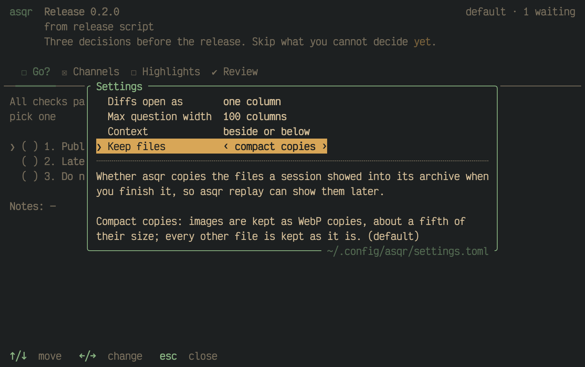

A session shows files by path, and many of them lie in temporary folders.
When you finish a session, asqr can keep a copy of every file it showed, so
that [a replay](01M68KBBY1Y1YB4YFQ8WC37QP5-finished-sessions-history-and-replay.md)
can show them later. This page says what asqr keeps, how it packs the
archive and how you delete from it.

## What asqr keeps

A kept file lies in `archive/files/<sha256>.<ext>` of the queue, or as
`files/<sha256>.<ext>` in a month bundle. `<sha256>` is the SHA-256 of the
kept bytes, so `shasum -a 256` on a kept file prints its name. A file shown
by several sessions is stored once for each place it lies in.

Before the result is written, asqr reads the files the session shows into
memory. An asker that removes its temporary files as soon as it sees the
result does not take away what you saw. After the session is finished, a
worker thread of asqr writes the copies and records them in the archived
session. The archived session is the JSON you saw, with an object `archived`
at the top and an object `shown` for each file that records its original
path, its state, its SHA-256 and its size. The state is one of:

- `kept`: a copy exists.
- `not_kept`: the file was read and fingerprinted, but no copy exists,
  because the setting says so or because the file is over the viewer's
  limit, 64 MiB for an image and 8 MiB for any other file.
- `missing`: there was no such file.
- `unreadable`: a relative path, something that is no regular file, or a
  read that failed.

A session that shows no file by path is archived as it is.

## The Keep files setting

The setting `keep_files` has three values.

| Value | The pane's name | What asqr keeps |
|---|---|---|
| `"compact"` (default) | `compact copies` | Images as WebP copies, about a fifth of their size, and every other file as it is. |
| `"exact"` | `exact copies` | Every file byte for byte, images included. |
| `"off"` | `no copies` | No file. asqr still records each file's size, modification time and SHA-256, so a replay can tell that the file is gone. |

Some images stay as they are even under `compact`: a WebP, a GIF, an
animated PNG, a TIFF with several pages, an ICO with several images, a
picture of more than 32 million pixels, an image with a profile for a
colour space other than RGB, and any image whose re-encoding is not smaller
or does not show the same picture.

You change the setting in the [settings pane](01M68C1XVEMX1D38GK6GY0V1NZ-settings.md),
on the row `Keep files`, or in `settings.toml`. The variable
`ASQR_KEEP_FILES` set to `compact`, `exact` or `off` wins over the file and
locks the row. A change applies to the next session you finish. The first
time asqr starts without a settings file, it asks the value on a
[first-start screen](01M68C1XVEMX1D38GK6GY0V1NZ-settings.md).

`asqr withdraw` and `asqr ask --replaces` keep no copies. They record each
file as `not_kept`.

### Quitting while copies are written

When you quit while the worker still has jobs, asqr gives the terminal back
first and prints `keeping the files of <n> finished sessions, ctrl-c lets
go of them...` on stderr. It waits up to 10 seconds for the worker to
finish its queue. `ctrl-c` ends the wait, and what is left is let go of.
Those sessions keep their plain archive entry, without copies.

## Compacting the archive

Nothing is deleted automatically, apart from the draft of a finished
session. `asqr compact` bundles finished sessions and results that are more
than 30 days old into one zip for each month, `archive/<YYYY-MM>.zip`.
The kept files of the bundled sessions go into the bundle with them, as
`files/` entries, and a file that several sessions of a month show is
bundled once. The asqr that starts watching a queue does this for the
queue, and `asqr compact --all` does it for every named queue.

Each bundle that took in entries prints as `<month>.zip: <n> sessions, <n>
results, <n> replaced results`. Without any, `nothing to compact` is
printed.

## Deleting with prune

`asqr prune` is the only way asqr deletes sessions and results, and it
deletes nothing without `--yes`. Without it, `prune` prints `would remove
<path>` for each file it would delete and ends with `nothing was removed;
run again with --yes to remove these`.

- `asqr prune --older-than <age>` deletes bundles and archive entries of
  months older than the age. An age is a whole number with one unit, `d`
  for days, `w` for weeks, `mo` for months of 30 days or `y` for years of
  365 days, at least 30 days, such as `90d`. A bundle goes once all of its
  month is older than the age. A kept file goes with the sessions that
  showed it, unless a session that stays shows it too. Results in the
  outbox are never deleted, and drafts never.
- `asqr prune --session <REF>` deletes one finished session, named by the
  reference `asqr history` prints. The kept files that only it showed go
  with it. The result of the session stays. A session that lies loose and
  in a bundle goes from both places. The two forms do not combine.
- A session or a bundle that cannot be read ends `prune` with an error and
  exit code 1, and nothing is removed, as it may show any kept file.

`prune` also removes every named queue that no asqr watches and that holds
no file.
