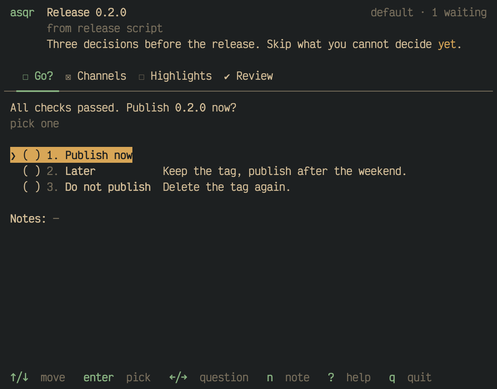
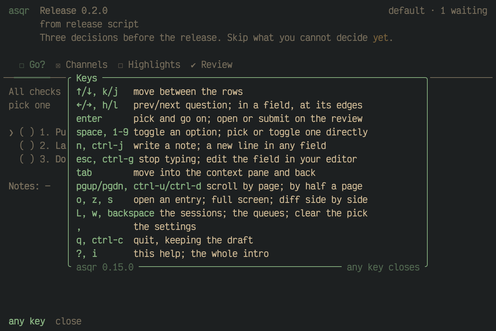

asqr shows one session at a time, with a tab for each question. You move
freely between the questions, answer them in any order and send all your
answers at the end. This page has what you need for most sessions, and the
pages after it have the details.

## The screen at a glance

- The title bar names the session and counts the sessions waiting.
- Under it stand who sent the session and its intro.
- The tab bar has a tab for each question, and the review as its last
  tab. A tab shows `☒` once its question is answered.
- The question and its options fill the middle.
- The key bar at the bottom names the keys that work where the cursor is.

[The screen](01M68BT9AJHW7WX304EQKGBGF6-the-screen.md) names every part.

## Pick, type and move on

- `↑`/`↓` (or `k`/`j`) move between the options.
- `enter` picks the option under the cursor and moves on to the next
  question. A digit from `1` to `9` picks that option, or toggles it in a
  multiple choice.
- In a multiple choice, `space` toggles an option and `enter` moves on.
- `←`/`→` (or `h`/`l`) go to the previous and the next question.
- In a text question, and on the last row of a question that takes your
  own answer, which starts with `✎`, what you type goes straight into the
  answer. `esc` leaves the field.
- `n` writes a note on the question.

Every question is optional, so skip what you cannot decide and say why in
a note if you like. An option marked `◀ default` is the asker's
recommendation, and left as it is, it counts as your answer. [Questions
and answers](01M68BT9AXJNJQR45K1FBR9VTG-questions-and-answers.md) explains
each kind of question.

## Context beside the question

When a question comes with a diff, a file or an image, asqr shows it in a
pane beside or below the question. `pgup`/`pgdn` scroll it while you stay
on the question. [Context: files, diffs and
images](01M68BT9B5R7ASMVGW9SHK8MB2-context-files-diffs-and-images.md) shows
the rest.

## Help

`?` shows the keys that work where you are.

## Send your answers

The last tab is the review, and `enter` on `[ Submit ]` sends your
answers. `q` quits and keeps them as a draft. [Review, submit and come
back later](01M68BT9BMFVCVEAACWR03B827-review-submit-and-come-back-later.md)
explains both.
